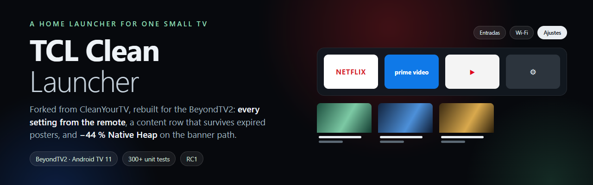
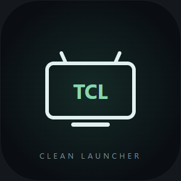
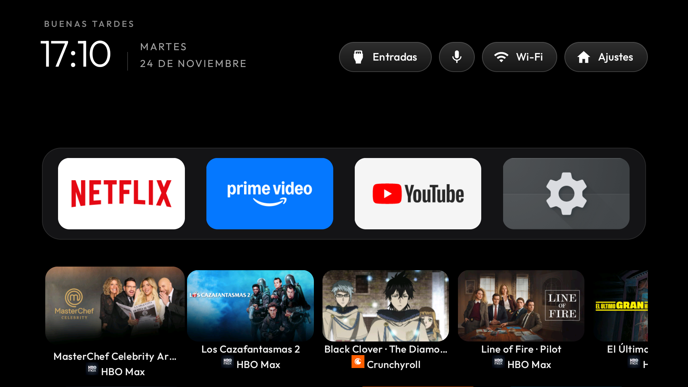
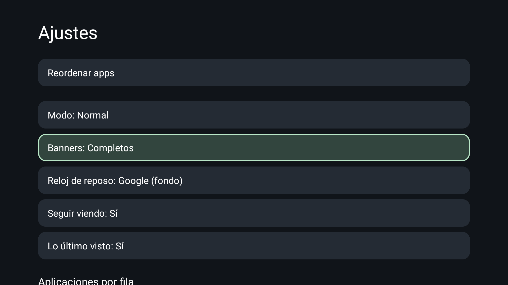

<p align="center">
  
</p>

<p align="center">
  
</p>

# TCL Clean Launcher

A Home launcher for **TCL Android TVs** — built on and verified for a TCL BeyondTV2 (RTD2851,
Android TV 11, AR05, 2 GB, 1080p), forked from
[CleanYourTV](https://github.com/Gathin23/cleanyourtv) v3.0 (MIT). The example configs for every
TCL model upstream documents live under [`examples/`](examples). **First release candidate:
[`v3.0.0-rc1`](https://github.com/mbilox/TCL-Clean-Launcher/releases/tag/v3.0.0-rc1).**

Everything this fork adds over upstream — every launcher option with screenshots, the sideways
watch-next row, and the measured memory wins — is documented in
**[docs/FEATURES.md](docs/FEATURES.md)**. The full RC1 notes are in
[docs/project/RELEASE-NOTES-RC1.md](docs/project/RELEASE-NOTES-RC1.md).

<p align="center">
  
  
</p>

## What this fork does differently

- **Every setting from the remote** behind the Ajustes pill — no PC, no adb to run the TV:
  Mode presets (Normal / Maximum optimization), banner memory modes, idle clock
  (ours / Google's rotating backdrop), rows, apps per row, dock opacity, background,
  animations, advanced effects, theme reset, app reordering, default-home picker.
- **A real content row** (up to 8 cards): poster with progress bar, caption always visible
  (title + app icon/name), deep link straight to the publishing app, full row reveal in both
  directions and column-preserving navigation — plus a disk cache + 7-day snapshot that keeps the
  row dressed when the apps' poster URLs expire and this board's TvProvider breaks.
- **Measured, not vibes**: banner path **−8,056 KB Native Heap (−44 %)** in Memory saver, PSS
  flat, jank 0.00 %, cold start 471–528 ms on the measured baseline. 300+ unit tests green.
  Charts and the numbers behind them: **[the "How fast" section of FEATURES.md](docs/FEATURES.md#how-fast)**.
- **Honest limits**: built and verified on this one unit; nothing tested on other TVs.

## Install

Download [`TCL-Clean-Launcher-3.0-rc1.apk`](https://github.com/mbilox/TCL-Clean-Launcher/releases/download/v3.0.0-rc1/TCL-Clean-Launcher-3.0-rc1.apk)
(376,259 B, SHA-256 `d4ff3885f29dba6847e9c10495c9be3b9397fdf5734ec279cb46402831b1f367`), then:

```
adb install -r TCL-Clean-Launcher-3.0-rc1.apk
```

and set it as Home (the TV asks, or use the launcher's own "Elegir inicio predeterminado").
Installation notes and restore paths for this board: [`docs/PROJECT/README.md`](docs/project/README.md)
and the upstream guides below.

## Known behaviour (not launcher defects)

- The **first mic press after a long idle** can fail silently — the firmware parks the voice chain
  and the press can arrive before the assistant is back up. The second press works.
- This firmware shows a TCL "switching to standby" dialog instead of the screensaver when
  `sleep_timeout` expires; the screensaver starts on the power/sleep path.

## Upstream

This fork keeps upstream's full README (with its install guides, issue triage and support links)
in **[README-UPSTREAM.md](README-UPSTREAM.md)**, and the localized ones
([README.zh-CN.md](README.zh-CN.md), [README.vi.md](README.vi.md), [README.ja.md](README.ja.md),
[README.it.md](README.it.md)) as they shipped. Upstream project and credit:
[Gathin23/cleanyourtv](https://github.com/Gathin23/cleanyourtv) (MIT).
