# What this fork adds over upstream CleanYourTV v3.0

Everything below is driven from the TV itself, no PC needed: the launcher settings live behind the
**Ajustes (Settings) pill** in the top bar, next to Entradas (inputs), the mic and Wi‑Fi.

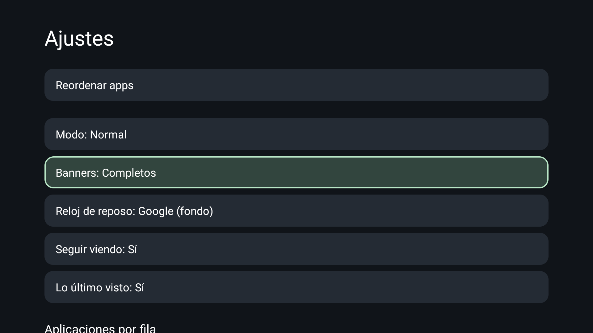

## The settings options

### Modo (Mode) — Normal / Maximum optimization
Two presets shipped inside the APK (`res/raw/tcl_normal.json`, `tcl_max.json`). **Normal** keeps
effects, wallpapers and skin. **Maximum optimization** turns off animations, effects, cinematic
layout, glow and wallpaper, always shows names, and forces banners to RGB 565 at 240 dpi. The
choice survives a force-close and it does **not** reset the Banners choice below.

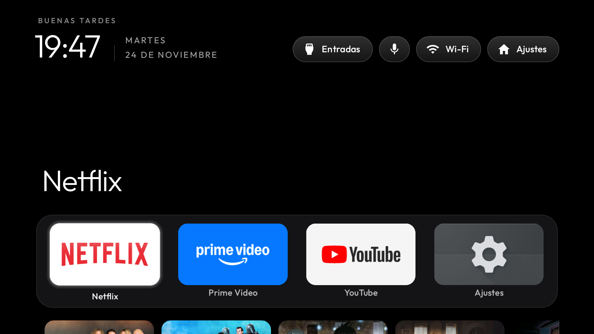
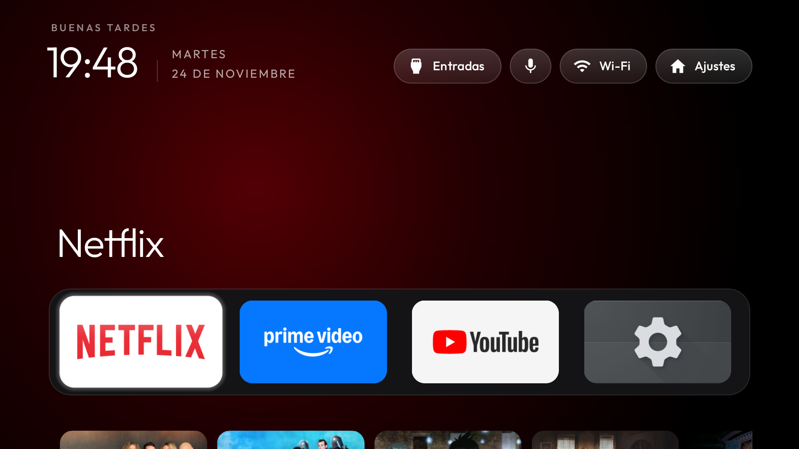

### Banners — Full / Memory saver / Icons only
An absolute choice that always wins over the preset and `config.xml`:

| State | What it does | Measured cost |
| --- | --- | --- |
| **Full** | Per-app banners at their native density, exactly upstream's default | baseline |
| **Memory saver** | Same look, banners decoded as RGB 565 at 240 dpi | −8,056 KB Native Heap (18,396 → 10,340 KB, −44 %), banner rubric ~7.7 MB → ~3.4 MB |
| **Icons only** | Uniform icon tiles, no banner bitmaps | the same route upstream issue #39 wants |

Full and Memory saver look identical — Memory saver is a memory decision, not a look decision.
Icons only changes the tiles:

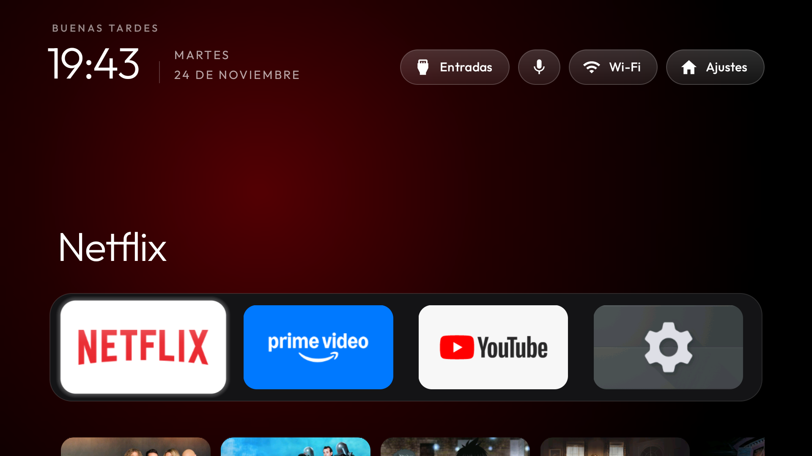
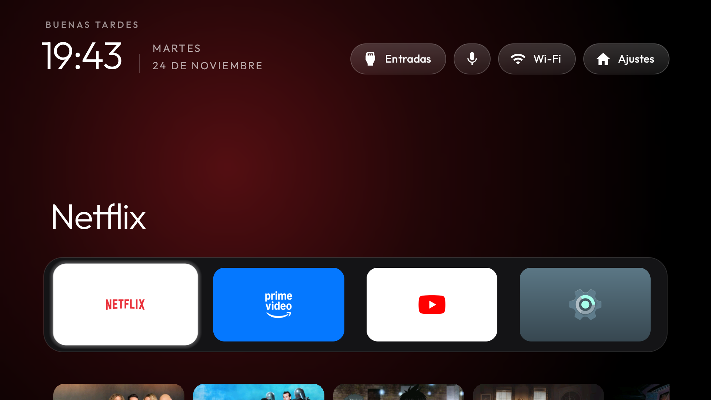

### Reloj de reposo (idle clock) — Ours / Google backdrop
- **Google backdrop**: our own clock never starts; the system screensaver takes over on idle
  (Google's clock over the rotating Android backdrop, `com.google.android.backdrop`).
- **Ours**: the fork's own clock (theme-timed, `home_idle_clock_minutes`).

### Seguir viendo / Lo último visto (rows)
Two independent switches. Seguir viendo keeps the recently-opened apps line under the dock; Lo
último visto adds the sideways content row (below).

### Aplicaciones por fila — 4 / 5 / 6 / 7
Tile width of the app grid. Six fits this 1080p board with 16:9 banners without scroll.

### Filas debajo del dock — 0 / 1 / 2 / 3
How many grid rows render under the dock before the row of content; 0 keeps everything in one
screen.

### Opacidad de la barra del dock — 100 / 70 / 50 / 30 %
Dock band transparency, for units where the dock draws too heavy.

### Fondo — Predeterminado del tema / wallpaper
Theme default or the owner's wallpaper (`config.json` overlay).

### Animaciones — Sí / No
Master motion switch. With **No**, "Efectos avanzados" grays out (it depends on animations).

### Efectos avanzados — Sí / No
Card lift, bigger icons, softer color changes (1.12 zoom, banner 1.035). Adds memory; the TV
decides. Default is No on this 2 GB board.

### Seguir el tema (restablecer ajustes)
Applies or resets the current theme's own layout/effects values, replacing the owner's choices.

### Reordenar apps / Elegir inicio predeterminado / Ajustes del televisor
Reorder opens the tile-move editor. Elegir inicio predeterminado hands the Home role to the
original launcher or back to this one (the original must be enabled). Ajustes del televisor opens
the system settings panel.

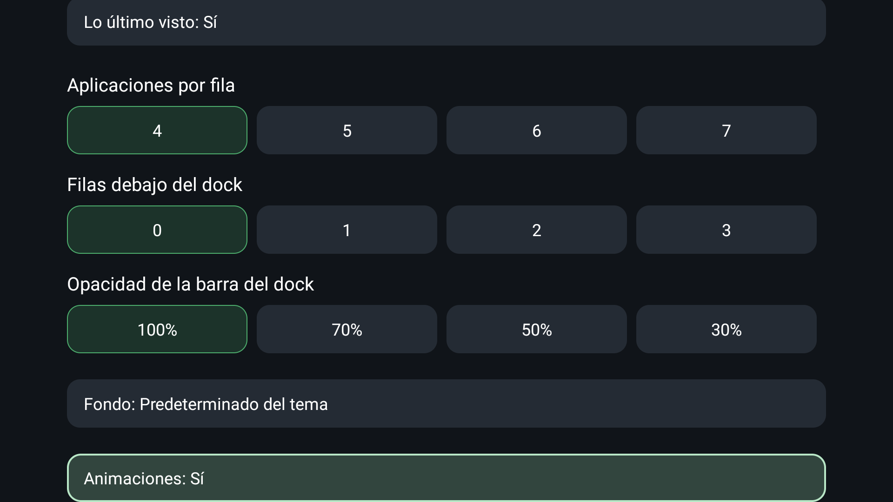
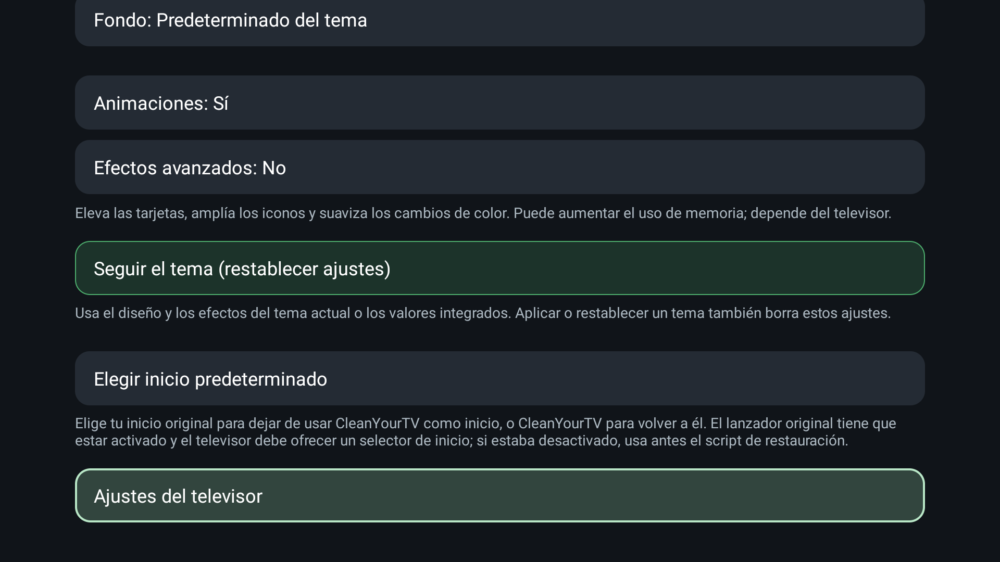

## The sideways content row (Lo último visto)

One full-width row holding up to 8 cards from the apps' published watch-next rows:

- Poster with the **progress bar** at its foot (position/duration the app publishes), and a
  two-line caption **always visible**: content title ellipsized to its own line, then the app's
  icon + name. No chip over the poster.
- Focusing a card zooms the poster (the caption slides 4 dp down to make room) — and every other
  caption stays visible. The row reveals fully in both directions: one DOWN from the dock shows
  poster + title + app badge for every card; one UP from the tiles below lands the full row at the
  focused column. Vertical navigation keeps the column in all four transitions (dock→row, row→dock,
  row→tiles, tiles→row).
- **OK opens the app directly**: the deep link is bound to the publishing app (verified end to end
  over logcat: `START {act=VIEW ... cmp=com.wbd.stream/.beam.BeamActivity}` with no resolver and
  no third-party search in between).

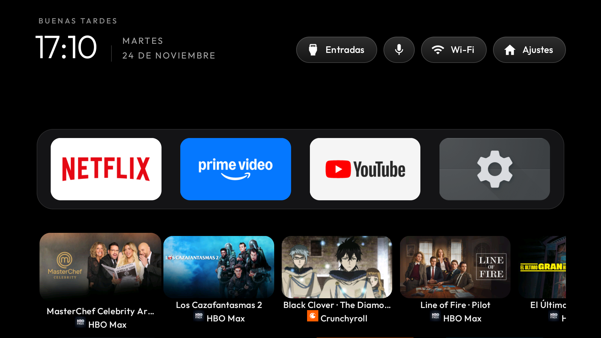
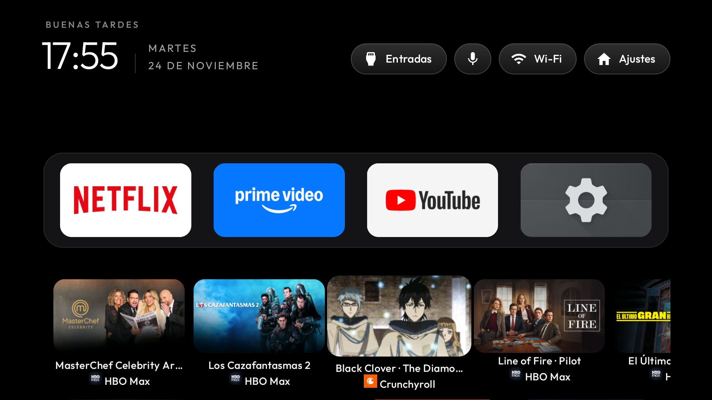
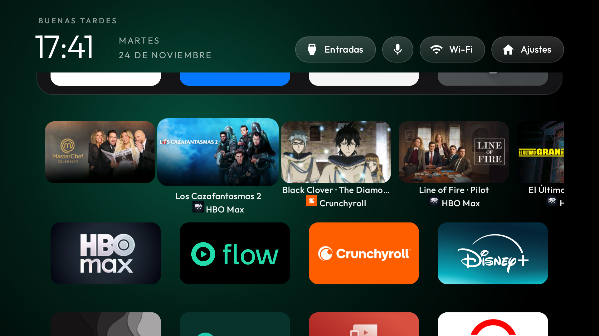

**Poster recovery**: the apps publish signed CDN URLs that expire within hours, and this board's
TvProvider breaks on the wide queries they use (`split_id` SQLiteException). The row keeps a disk
cache of posters (`cache/posters/`) and its own 7-day JSON snapshot, so expired URLs fall back to
the cached art and a broken provider read falls back to the snapshot instead of an empty row.

## Inputs and the voice pill

Entradas opens HDMI 1/2/3 + AV. The voice pill (`btnVoice`) is what keeps the TCL remote's
microphone chain alive on this board: the firmware turns the remote's mic button into a synthetic
click on the Home's own voice button. A Home without that view loses the mic.

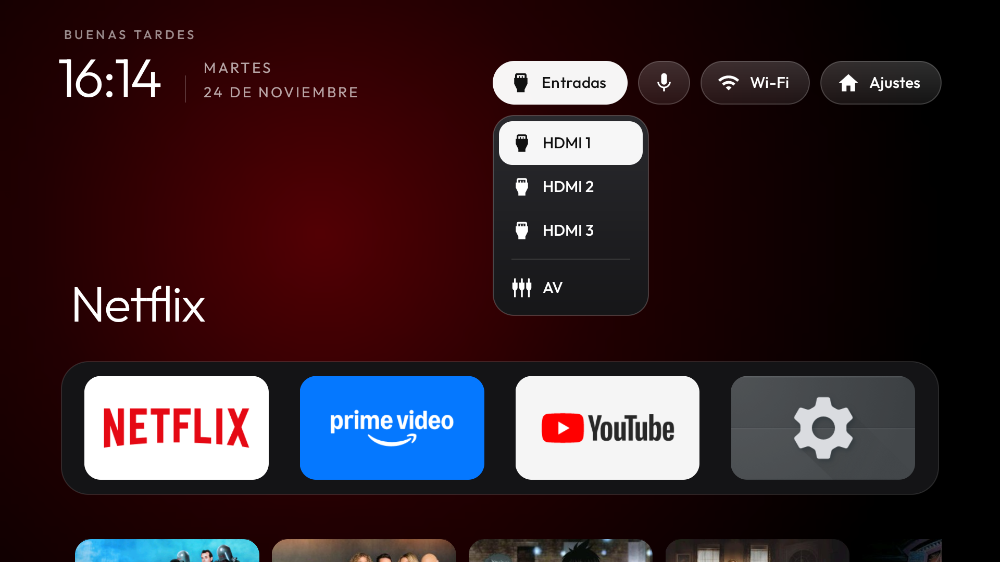

## How fast

On this unit (BeyondTV2, RTD2851, Android TV 11, 2 GB, 1080p), measured on the set itself with
heapprofd and platform traces (the fork's measurement method in one line: A/B runs of the same
build with the only variable being the banner decode path, heap attributed per call site):

- Native Heap for the banner path **−8,056 KB (−44 %)** in Memory saver, PSS flat.
- Jank 0.00 %, cold start 471–528 ms, PSS ~29 MB (the measured baseline build), idle 2 frames/30 s,
  CPU 0.0–0.2 %.
- Single-pass grid drawing (upstream #446 adapted), subsetted typeface, pruned banner drawables
  (−8 MB on install).
- The unit's suite: 300+ unit tests green plus lint, and every behavioural fix above verified on
  the physical TV (captures referenced here are ADB screencaps of the release candidate).

## Known behaviour that is not a launcher defect

- **First mic press after a long idle can fail silently.** The voice chain is firmware
  (`com.tcl.guard` → `com.tcl.assistant` → katniss); Android parks those processes on idle, and the
  first press can arrive before the assistant is up again — the intent then reaches katniss without
  an audio stream and gets rejected. The second press works. Keeping the chain alive would cost
  ~200 MB of RAM on a 2 GB board, so the launcher does not do it.
- This firmware's sleep path shows a TCL "switching to standby" dialog instead of the dream when
  `sleep_timeout` expires; the screensaver starts on the power/sleep path.

## Version

Release candidate RC1: `ar.TCL.cleanLauncher`, versionCode 9, versionName `3.0`, APK 376,259 B,
SHA-256 `d4ff3885f29dba6847e9c10495c9be3b9397fdf5734ec279cb46402831b1f367` — see
[`project/RELEASE-NOTES-RC1.md`](project/RELEASE-NOTES-RC1.md) for the full notes and the gate.
